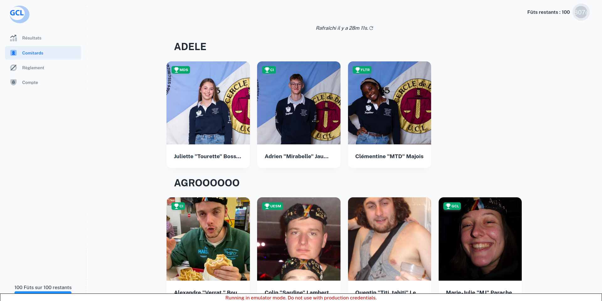

## MercatosGCL

> Website for the GCL mercatos

## Link
- [Public link](https://mercatosgcl.web.app/)

## Quick start

- **Clone** `git clone https://github.com/riri-314/mercatosGCL.git`
- Use Node.js 22.12+ or 24.x (Vite also supports Node.js 20.19+).
- **Install:** `npm install`
- **Start:** `npm run dev`
- **Build:** `npm run build`

Development and preview bind to `127.0.0.1`. To deliberately expose the development
server, run `npm run dev -- --host`. Run `npm run test:dev-security` to check local
file access restrictions and the default binding.

## Emulator
First change debug to true in firebase_config.ts

### Importing firestore data to local storage: 

gsutil -m cp -r gs://bucket_export_test/2025-02-10T17\:25\:33_46845 ~/git/mercatosGCL

source: https://stackoverflow.com/questions/57838764/how-to-import-data-from-cloud-firestore-to-the-local-emulator

### Start the emulator
firebase emulators:start --import ./2025-02-10T17:25:33_46845 --export-on-exit

### Backend regression tests

Run `npm ci --prefix functions`, then `npm test --prefix functions`.
The tests build the backend and start an isolated Firestore emulator using the
`demo-mercatos-security` project. Java is required. Tests refuse to run against
production and do not import the repository's account or database exports.

Todo Henri:
modifier supprimer encheres, tout à faire

Todo Flo:
modifier supprimer encheres, tout à faire
changer create comitard pour avoir petite photo
optimiser page résultats, trop lente
